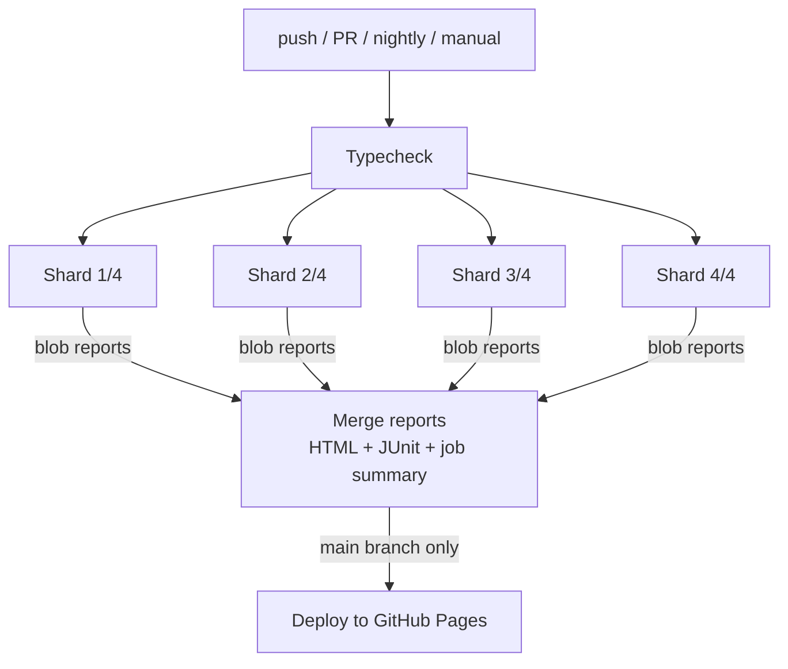

# Playwright + TypeScript E2E Framework

[](https://github.com/<your-github-username>/playwright-saucedemo-framework/actions/workflows/playwright.yml)
[](https://<your-github-username>.github.io/playwright-saucedemo-framework/)

A production-style test automation framework for the [Sauce Demo](https://www.saucedemo.com) e-commerce app, plus API suites for [Restful-Booker](https://restful-booker.herokuapp.com) (authenticated CRUD) and [JSONPlaceholder](https://jsonplaceholder.typicode.com). It's built the way I'd set one up for a real team: Page Object Model, fixtures-based dependency injection, a reusable authenticated session, cross-browser runs, sharded CI and published reports.

## Highlights

| Area | What's implemented |
| --- | --- |
| **Design pattern** | Page Object Model with a `BasePage`, reusable components (`HeaderComponent`) and API service objects (`BookingClient`, `PostsClient`) |
| **Fixtures** | Custom `test` that injects every page object and API client, so specs never call `new` |
| **Auth** | UI: a `setup` project logs in once and saves `storageState`. API: a worker-scoped fixture fetches the token once per worker |
| **API testing** | Full authenticated CRUD lifecycle, contract checks with [zod](https://zod.dev) schemas, security checks (no token -> 403), negative payloads, and self-cleaning test data |
| **Test data** | Kept apart from tests in `src/data`, with a `buildBooking()` factory for unique data and data-driven (parameterised) cases |
| **Coverage** | 28 UI scenarios x 3 browsers (Chromium, Firefox, WebKit) + 18 API tests |
| **Tagging** | `@smoke`, `@regression`, `@e2e`, `@api`, `@security`, `@healing`, so CI or a developer can run any slice |
| **Locators** | User-facing `getByRole` plus `getByTestId` mapped to the app's `data-test` attributes, no brittle CSS/XPath |
| **Self-healing** | Runtime fallback locators on critical controls, with every heal reported in the HTML report and CI summary, plus Playwright's AI healer agent for fixing broken tests ([details](#self-healing-locators)) |
| **Stable waits** | Every page object declares a page-unique element; `expectLoaded()` checks the URL *and* that element, so tests never read the previous page during client-side navigation |
| **Debuggability** | Trace on first retry, screenshot and video kept on failure, `test.step` blocks in long flows |
| **CI/CD** | GitHub Actions: typecheck gate -> 4-way sharded run -> merged HTML + JUnit report -> GitHub Pages |
| **Reporting** | Playwright HTML report, JUnit XML, a Markdown job summary and inline PR annotations |

## Project structure

```
.
|-- .claude/agents/                    # Playwright test agents: planner, generator, healer
|-- .github/workflows/playwright.yml   # CI pipeline
|-- .mcp.json                          # Playwright test MCP server used by the agents
|-- playwright.config.ts               # projects, reporters, retries, artifacts
|-- scripts/junit-summary.mjs          # JUnit -> GitHub job summary (results, failures, heals)
|-- specs/                             # test plans written by the planner agent
|-- src/
|   |-- api/
|   |   |-- BookingClient.ts           # Restful-Booker service object (auth + CRUD)
|   |   |-- PostsClient.ts             # JSONPlaceholder service object
|   |   `-- schemas/booking.ts         # zod response contracts
|   |-- components/HeaderComponent.ts  # shared UI component
|   |-- config/env.ts                  # env-driven URLs and credentials
|   |-- data/                          # users, products, checkout, booking factory
|   |-- fixtures/test.ts               # page objects, API clients, token + booking fixtures
|   |-- pages/                         # page objects (BasePage + 7 pages)
|   `-- utils/HealingLocator.ts        # self-healing locator with reporting
`-- tests/
    |-- setup/auth.setup.ts            # logs in once, saves storage state
    |-- ui/                            # login, inventory, cart, checkout, self-healing + agent seed
    `-- api/                           # booking (CRUD/auth/negative) + posts specs
```

## Getting started

```bash
npm ci
npx playwright install --with-deps
```

| Command | What it does |
| --- | --- |
| `npm test` | Full suite: all browsers + API |
| `npm run test:chromium` | Chromium + API only (fast local loop) |
| `npm run test:smoke` | Only `@smoke` tests |
| `npm run test:regression` | Only `@regression` tests |
| `npm run test:api` | API tests only |
| `npm run test:strict` | Full suite with self-healing **off**, proving every primary locator still works |
| `npm run test:headed` | Watch the browser run |
| `npm run test:debug` | Step through with the Playwright Inspector |
| `npm run report` | Open the last HTML report |
| `npm run typecheck` | TypeScript type check |

### Configuration

| Variable | Default |
| --- | --- |
| `BASE_URL` | `https://www.saucedemo.com` |
| `API_BASE_URL` | `https://jsonplaceholder.typicode.com` |
| `SAUCE_PASSWORD` | `secret_sauce` (public demo credential) |
| `SELF_HEALING` | `true`; set `false` to disable fallback locators |
| `BOOKING_API_URL` | `https://restful-booker.herokuapp.com` |
| `BOOKING_USERNAME` / `BOOKING_PASSWORD` | `admin` / `password123` (public demo credentials) |

## Example: what a spec looks like

```ts
test('completes an order end to end', { tag: ['@smoke', '@e2e'] }, async ({
  checkoutInfoPage, checkoutOverviewPage, checkoutCompletePage,
}) => {
  await checkoutInfoPage.fillCustomerInfo(validCustomer);
  await checkoutInfoPage.continue();
  await checkoutOverviewPage.finish();
  await expect(checkoutCompletePage.header).toHaveText('Thank you for your order!');
});
```

And an API test, where the token and a self-cleaning booking come from fixtures:

```ts
test('DELETE without a valid token is forbidden and the booking survives', async ({
  bookingClient, createdBooking,
}) => {
  const response = await bookingClient.delete(createdBooking.bookingid, 'invalid-token');
  expect(response.status()).toBe(403);

  const check = await bookingClient.get(createdBooking.bookingid);
  expect(check.status()).toBe(200);
});
```

## Self-healing locators

"Self-healing" covers two different things. This framework does both, and keeps each one deliberately narrow.

### 1. Runtime fallbacks (during the test run, no AI)

`HealingLocator` (`src/utils/HealingLocator.ts`) gives a critical control a primary locator plus ordered fallbacks:

```ts
this.submit = new HealingLocator('Login › submit', page.getByTestId('login-button'), [
  page.getByRole('button', { name: 'Login' }),
  page.locator('#login-button'),
]);
```

If the primary stops matching but a fallback works, the test continues and the heal is **recorded, not hidden**:

- as a `self-healed-locator` annotation on the test in the HTML report
- in a "Self-healed locators" section of the GitHub Actions job summary
- as a `[self-healing]` warning in the console

**Why it's opt-in and limited to a few controls** (login fields, add to cart, checkout): silent healing is dangerous. If the "Checkout" button disappears and the test clicks some other element instead, a real regression passes as green. So the framework:

- uses healing only where a broken locator would block many tests, not on assertions
- reports every heal, so it gets fixed in the page object
- offers `npm run test:strict` (`SELF_HEALING=false`) to prove the primary locators work without fallbacks
- includes `tests/ui/self-healing.spec.ts`, which strips `data-test` attributes or changes button text to simulate a UI change, then checks that each heal both happens and is reported

### 2. AI healer agent (while you're coding, uses an LLM)

Generated with `npx playwright init-agents --loop=claude`, the `.claude/agents/` folder contains Playwright's **planner**, **generator** and **healer** agents. They drive a real browser through the Playwright test MCP server (`.mcp.json`).

When a test breaks, ask Claude Code to *"use the playwright-test-healer agent to fix the failing tests"*. It replays the test, inspects the live page, and proposes a fixed locator or step for you to review in the diff.

The generic agent prompt has **project rules** added (`.claude/agents/playwright-test-healer.md`):

- fix locators in page objects, never inline them in specs
- **never weaken an assertion** to make a test pass; if the app's behaviour changed, mark the test `fixme` and flag a possible bug
- update the *primary* locator when a runtime heal was reported
- verify the fix on all three browsers and run the type check

> `.mcp.json` launches the server with `cmd /c` (Windows). On macOS/Linux, change it to `"command": "npx", "args": ["playwright", "run-test-mcp-server"]`.

| | Runtime fallbacks | AI healer agent |
| --- | --- | --- |
| When | Every test run, including CI | On demand, while developing |
| Fixes the code? | No: keeps the run going and reports the break | Yes: proposes a code change for review |
| Needs an LLM? | No | Yes (Claude Code) |
| Main risk | Hiding real regressions, mitigated by reporting and strict mode | Bad "fixes", mitigated by project rules and code review |

## CI/CD pipeline



- **Triggers:** push and PR to `main`, a nightly schedule, and manual dispatch with an optional `grep` input (for example `@smoke`).
- **Sharding:** tests are split across 4 parallel runners, and blob reports are merged into a single report.
- **Reliability:** 2 retries in CI, with traces captured on retry for flaky-test analysis.
- **Publishing:** the latest `main` report goes live on GitHub Pages.

### Enabling the GitHub Pages report

In your repo go to **Settings -> Pages -> Build and deployment -> Source: GitHub Actions**.

## Author

Muthukumar, QA Automation Engineer (11 years in test automation)
